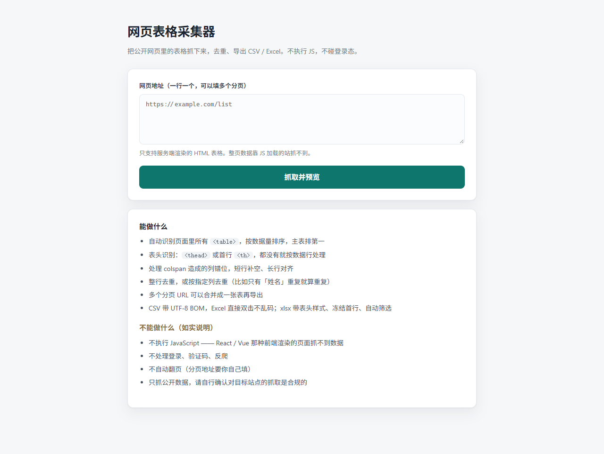
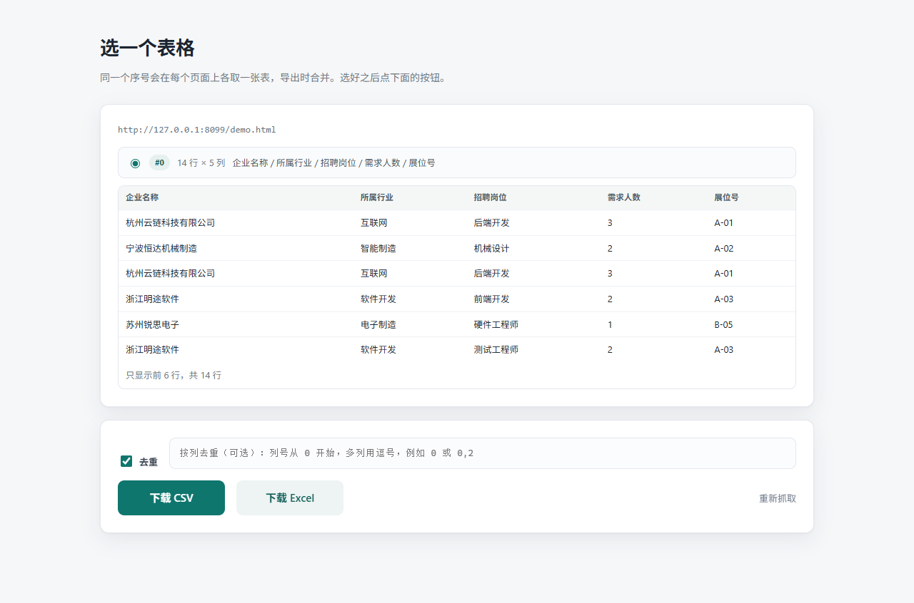

# 网页表格采集器 Table Harvester

把公开网页里的表格抓下来，**清洗、去重、导出成 CSV / Excel**。
命令行和网页界面两种用法，核心逻辑是一个可以当库调用的 `harvester.py`。

## 解决什么问题

经常有人需要把网页上的一批数据搬到 Excel 里：企业名录、商品价格、报名名单、公开统计表。
手工复制粘贴一百行就崩溃了，而且很容易重复、错位。

这个工具做的事很具体：

- 打开十个分页，把每页的主表格抓下来
- 去重（整行重复，或只按某一列判重）
- 导出成能直接用的 CSV / xlsx

## 截图

| 首页 | 抓取预览（14 行原始 / 去重后 9 行） |
|---|---|
|  |  |

## 快速开始

```bash
pip install -r requirements.txt
```

### 命令行

```bash
# 抓第一个表格 → data.csv
python cli.py https://example.com/list

# 先看看页面里有几个表格
python cli.py https://example.com/list --list-tables

# 抓第 2 个表格，导出 Excel
python cli.py https://example.com/list --table 1 --excel -o 名单.xlsx

# 三个分页合并，按第 1 列（列号 0）去重
python cli.py "https://example.com/p1" "https://example.com/p2" "https://example.com/p3" \
    --key 0 -o 合并数据.csv
```

### 网页界面

```bash
python app.py      # 打开 http://127.0.0.1:5002
```

填地址（可多个，一行一个）→ 预览所有表格（显示行数、列数、表头、前 6 行）→ 勾去重 → 下载 CSV 或 Excel。

### 当库用

```python
from harvester import fetch_html, find_tables, dedupe, to_csv

html = fetch_html("https://example.com/list")
tables = find_tables(html)                 # 按数据量从大到小排好
headers, rows = tables[0]["headers"], tables[0]["rows"]
rows = dedupe(rows, key_cols=[0])
to_csv("out.csv", headers, rows)
```

## 实现要点

**表头识别**按这个顺序判断：`<thead>` → 首行单元格是否全是 `<th>` → 都没有就当无表头，第一行也是数据。
三种都试过才敢下结论，因为真实网页里这三种写法各占三分之一。

**列对齐**：`colspan` 会按跨度重复单元格文本，保证每行列数一致；短行补空、长行截齐。
不做这一步，CSV 一定会错列。

**重复表头**：有些站在 `<tbody>` 里又重复一遍表头行，会被识别并剔除。

**编码**：中文站经常在 `Content-Type` 里不写 charset，requests 默认按 ISO-8859-1 解，直接拿到满屏乱码。
这里优先用响应声明的编码，声明缺失或不合理时才用 `apparent_encoding` 探测。

**去重保序**：用 `set` 记录见过的 key，第一次出现的保留，所以输出顺序和网页顺序一致。

**CSV 带 UTF-8 BOM**：不加 BOM，Excel 双击打开中文就是乱码。这是接单时最常被客户提出来的问题。

**xlsx 不是裸数据**：表头加粗蓝底、冻结首行、按内容估算列宽（中文按 2 字符宽算）、加自动筛选。

**不执行 JavaScript**。这是清醒的取舍：用 Selenium 能覆盖更多站，但要装浏览器、慢十倍、还容易被封。
README 里直接写明限制，比假装全能更专业——客户要的就是「这个能不能做」，答不上来才丢单。

## 测试

```bash
python tests/selftest.py
```

```
36 passed, 0 failed
```

全部离线，不联网。覆盖：三种表头识别、colspan 对齐、重复表头剔除、多表排序、空行清洗、
整行去重 / 按列去重 / 保序、多表合并与列数不一致跳过、CSV BOM、Excel 表头样式与冻结与筛选、
`harvest()` 端到端流程、无表格报错、表序号越界报错、非法协议报错。

## 目录结构

```
table-harvester/
├── harvester.py        # 核心库：抓取 / 解析 / 清洗 / 去重 / 导出
├── cli.py              # 命令行
├── app.py              # 网页界面（Flask，两阶段：预览 → 导出）
├── templates/{index,preview}.html
├── static/style.css
├── tests/selftest.py
└── requirements.txt
```

## 已知限制（如实写）

- 不执行 JS，前端渲染的页面抓不到
- 不处理登录、验证码、反爬
- 不自动翻页，分页 URL 要自己填
- 不处理 `rowspan`（会在后续行产生空位，但不会丢数据）
- 网页界面把抓取结果缓存在内存里，10 分钟过期，多进程部署要换成 Redis

## 合规

只抓公开可访问的页面。抓之前请确认目标站点的服务条款和 `robots.txt`；
命令行可以用 `--robots` 让它先检查 `robots.txt`。涉及个人信息的数据请注意《个人信息保护法》的边界。

## License

MIT
